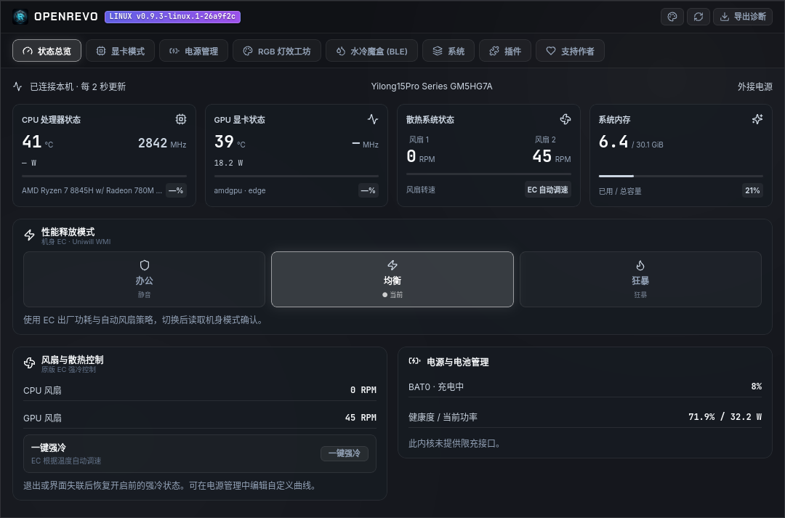

# OpenRevo for Linux

[简体中文](README.md) | [English](README_en.md)


[](https://github.com/Duskriver/open-revo-linux/actions/workflows/linux.yml)
[](LICENSE)

面向机械革命笔记本的社区 Linux 控制中心，由 [Duskriver](https://github.com/Duskriver) 基于 [faintonce/open-revo](https://github.com/faintonce/open-revo) 开发。沿用 Rust、Tauri 2、React 和原有硬件协议积累，当前仅以 Linux 为开发、构建和发布目标。

**当前为预览版。** 标准系统接口按内核能力提供功能；OEM EC 控制仅支持明确核验的机型和 BIOS。部分调校功能已有实现与软件测试，仍待接电带载实测。发布包的功能以对应 Release 说明为准，可能落后于 `main`。

[下载 Linux 预览版](https://github.com/Duskriver/open-revo-linux/releases) · [功能与安装说明](docs/linux-port.md) · [分阶段重构记录](docs/linux-refactor.md) · [问题反馈](https://github.com/Duskriver/open-revo-linux/issues)

## 界面



提供硬件状态、性能模式、功耗与风扇调校、电池管理、系统设置，以及 Mono / Cyber 两种主题。暂未实现的功能会显示支持状态，缺失的传感器数据保持为未知。

## 当前功能范围

| 功能 | Linux 实现与边界 |
| --- | --- |
| CPU、内存、电池与供电监测 | 使用 `/proc`、sysfs 和 power_supply；温度、转速、功率取决于 hwmon 或机型驱动 |
| 系统与平台性能档位 | 接入 power-profiles-daemon / tuned-ppd 和 ACPI `platform_profile`，按系统授权操作并核对读回 |
| 标准风扇与功耗接口 | 发现支持的 hwmon / powercap 通道后提供强冷或功耗上限控制，要求设备权限与有效范围 |
| 屏幕和单色键盘背光 | 使用 backlight / leds 与 systemd-logind，取决于内核接口和桌面会话权限 |
| 电池限充 | 内核提供 `charge_control_end_threshold` 且当前进程有权限时可用；验证机型目前未公开此接口 |
| OEM 风扇强冷与恢复 | 新事务驱动在 GM5HG7A 完成 5 秒强冷及释放恢复验证，控制状态与故障标志检查通过 |
| OEM 办公 / 均衡 / 狂暴模式 | 新事务驱动完成办公及接电均衡/狂暴写入读回，模式切换后恢复通过；实际性能效果未做负载验证 |
| OEM CPU 功耗与自定义风扇曲线 | 35/35/70 W 自定义功耗写回与原模式恢复通过；曲线具有软件故障测试，实际功耗与带载散热仍待验证 |
| 桌面集成 | 原生窗口、单实例、登录启动、托盘菜单、双主题和诊断导出；托盘显示取决于桌面环境 |

RGB 多色灯效、灯带、BLE 水冷、GPU MUX / 超频、全局快捷键 / OSD 和插件运行环境尚未实现。详细能力、权限和验证范围见 [Linux 功能说明](docs/linux-port.md)。

系统性能档位与 OEM 机身模式是不同的控制层。寄存器或档位读回成功，也不代表实际 CPU 功耗、性能或散热效果已经完成验证。

## 机型支持

标准监测和系统控制按 Linux 内核公开的接口发现，不要求 OEM 模块。

当前 OEM EC 模块只匹配以下组合：

| 项目 | 值 |
| --- | --- |
| 系统厂商 | `MECHREVO` |
| 主板 | `GM5HG7A` |
| BIOS | `N.1.09MRO19` |

已有硬件记录来自 Ryzen 7 8845H、Ubuntu 26.04.1、内核 `7.0.0-38-generic`。这不代表其他型号、BIOS 或内核版本已验证；固件更新后也需要重新核验匹配范围。未知机型继续使用可发现的标准接口。

均衡 / 狂暴、OEM CPU 功耗及自定义曲线应用要求系统外接供电状态与 EC 圆口电源标志同时满足。电池或仅 Type-C 供电时保留相应限制。曲线可以先编辑并保存草稿，启动时不会自动应用。

## 安装与运行

从本 Fork 的 [Releases](https://github.com/Duskriver/open-revo-linux/releases) 获取 Debian 应用包、对应源码和校验文件，阅读该版本说明后使用发行版包管理器安装。

通过桌面应用启动器以普通用户运行 OpenRevo。应用使用系统 GTK / WebKitGTK，不需要 Wine。OEM 功能另需匹配的 `openrevo_ec` 内核模块；应用包可用不代表模块已安装或机型已匹配。驱动安装、权限、内核升级和 Secure Boot 说明见 [Linux 安装文档](docs/linux-port.md)。

## 从源码构建

需要 Rust stable、Node.js 22 和 pnpm 9.15.9。Ubuntu / Debian 构建依赖示例：

```sh
sudo apt install build-essential pkg-config libwebkit2gtk-4.1-dev \
  libayatana-appindicator3-dev librsvg2-dev patchelf
```

```sh
git clone https://github.com/Duskriver/open-revo-linux.git
cd open-revo-linux
pnpm install --frozen-lockfile
pnpm linux:dev
```

构建 Debian 应用包：

```sh
pnpm linux:build
```

程序和安装包分别输出到 `src-tauri/target/release/open-revo` 与 `src-tauri/target/release/bundle/deb/`。构建产物依赖系统动态库，应在目标发行版验证兼容性。

## 诊断与验证

无图形界面的默认诊断命令只读取状态：

```sh
cargo run --manifest-path src-tauri/Cargo.toml -p openrevo-core --bin openrevo-probe
```

界面也可导出诊断 JSON，包含机型、主板、BIOS、内核、能力和传感器状态，不收集序列号。反馈问题时请附上版本、发行版、内核、BIOS、问题步骤和相关诊断信息。

基础开发检查：

```sh
python3 scripts/check_vault_leaks.py
pnpm linux:check
pnpm build
```

核心测试使用临时系统接口和内存 EC；原生窗口测试覆盖真实 Tauri IPC、导航、主题和控制界面夹具。默认原生窗口回归不会写真实硬件，实机写入检查需要显式开启。测试方法和每阶段结果见 [功能与验证文档](docs/linux-port.md) 和 [重构记录](docs/linux-refactor.md)。

## 开发结构

| 位置 | 职责 |
| --- | --- |
| `src/` | Linux React 界面、类型化 IPC 与状态轮询 |
| `src-tauri/src/` | Tauri 窗口、托盘与命令宿主 |
| `src-tauri/crates/openrevo-core/` | Linux 系统接口、硬件规则、遥测与控制核心 |
| `src-tauri/config/ec_registry.json` | 集中的寄存器、掩码与协议字典 |
| `drivers/openrevo-ec/` | 机型专用 WMI / EC 内核模块 |
| `tests/` | 隔离门禁与原生窗口回归 |

开发遵守 [AGENTS.md](AGENTS.md)，在 `main` 分阶段推进，以 Tag 发布。当前重构保留既有 Linux 功能和硬件策略语义；硬件控制变化需分别通过软件测试与相应实机验证。Windows 软件及其使用说明请访问 [原上游项目](https://github.com/faintonce/open-revo)。

## 来源、许可与支持

本项目保留上游历史和版权声明，按 **GPL-3.0-or-later** 分发，许可文本见 [LICENSE](LICENSE)。本说明不增加额外的许可限制。

OpenRevo 名称、[横幅](docs/logo_s.jpg)、[图标](src/assets/logo.png)及原有界面素材沿用上游。界面中的“支持作者”页面及赞助图片来自 [上游赞助页面源码](https://github.com/faintonce/open-revo/blob/main/src/components/SponsorView.tsx) 和 [上游赞助资源](https://github.com/faintonce/open-revo/tree/main/src/assets/sponsor)，展示的是上游作者的渠道。Linux 适配反馈与贡献请提交到 [本 Fork](https://github.com/Duskriver/open-revo-linux)。

感谢 [faintonce/open-revo](https://github.com/faintonce/open-revo) 的原始实现、[BetterRGB](https://github.com/ZavierChen/BetterRGB-ITE8291-Adaptive) 的相关探索，以及 [TUXEDO 驱动项目](https://github.com/tuxedocomputers/tuxedo-drivers) 提供的 Linux 协议参考。

本项目由社区独立维护，并非机械革命或同方官方软件。
