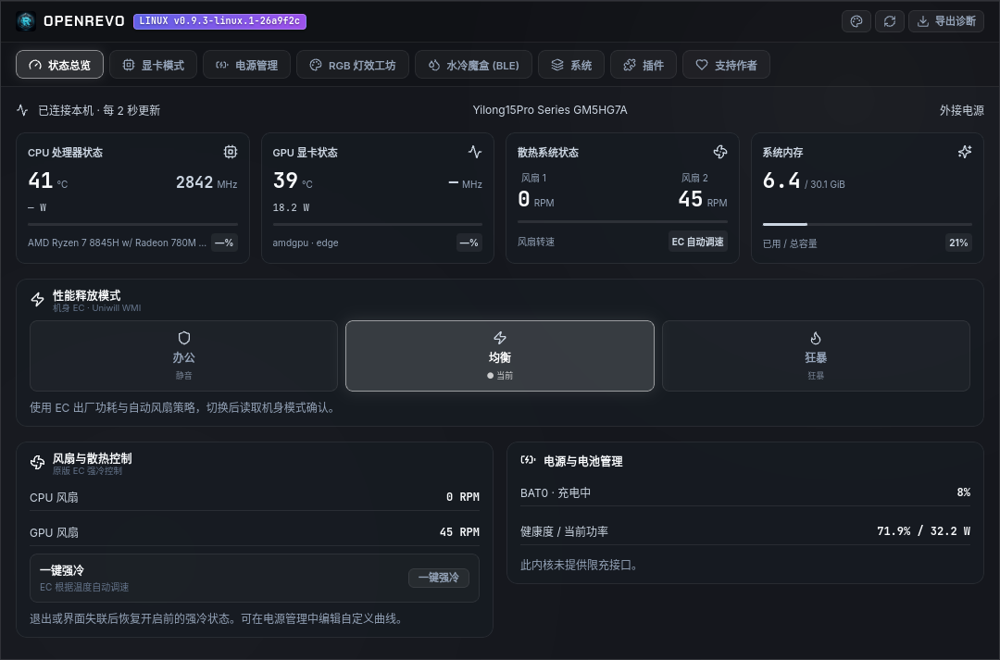

# OpenRevo for Linux

[简体中文](README.md) | [English](README_en.md)


[](https://github.com/Duskriver/open-revo-linux/actions/workflows/linux.yml)
[](LICENSE)

A community Linux control center for MECHREVO laptops, maintained by [Duskriver](https://github.com/Duskriver) and derived from [faintonce/open-revo](https://github.com/faintonce/open-revo). It retains Rust, Tauri 2, React and the upstream hardware protocol work. Linux is the sole development, build and release target of this fork.

**This is a preview.** Standard controls depend on interfaces exposed by the Linux kernel. OEM EC controls are limited to an explicitly verified model and BIOS. Some tuning features are implemented and software-tested but still await powered, under-load hardware validation. Released packages may lag behind `main`; consult the notes for the version you install.

`0.9.3-linux.2` combines the GUI and DKMS driver source in one complete `.deb`. Installation, native-window tests and a short fan-boost/restore test have passed on the maintainer's machine; see the [release notes](docs/linux-release-notes.md).

[Linux downloads](https://github.com/Duskriver/open-revo-linux/releases) · [Capabilities and installation](docs/linux-port.md) · [Phased refactoring record](docs/linux-refactor.md) · [Issue tracker](https://github.com/Duskriver/open-revo-linux/issues)

## Interface



The interface includes hardware status, performance modes, power and fan tuning, battery management, system settings, and Mono / Cyber themes. Features awaiting implementation are identified in the UI. Missing sensor measurements remain unknown.

## Current capabilities

| Feature | Linux implementation and limits |
| --- | --- |
| CPU, memory, battery and power monitoring | Uses `/proc`, sysfs and power_supply; temperature, RPM and power readings depend on hwmon or the model-specific driver |
| System and platform profiles | Integrates power-profiles-daemon / tuned-ppd and ACPI `platform_profile`, following system authorization and checking readback |
| Standard fan and power controls | Offers full-speed requests or power limits on supported hwmon / powercap channels, subject to permissions and valid limits |
| Display and monochrome keyboard brightness | Uses backlight / leds and systemd-logind, subject to kernel support and desktop session permissions |
| Battery charge limit | Available when the kernel exposes `charge_control_end_threshold` and access is permitted; the verified machine currently lacks this interface |
| OEM fan boost and restore | The new transaction driver passed a five-second boost and release-restoration test on GM5HG7A, including control-state and fault checks |
| OEM office / balanced / turbo modes | The new transaction driver passed office and AC-powered balanced/turbo write/readback and mode-restoration tests; performance under load remains unverified |
| OEM CPU limits and custom fan curves | A 35/35/70 W custom tuple and original-mode restoration passed; fan curves have software fault tests, while actual power and cooling under load remain unverified |
| Desktop integration | Native window, single instance, login startup, tray menu, two themes and diagnostics export; tray availability depends on the desktop |

Multicolor RGB effects, light bars, BLE water cooling, GPU MUX / overclocking, global shortcuts / OSD and the plugin runtime are not implemented. See the [Linux capability document](docs/linux-port.md) for detailed permissions and verification status.

System profiles and OEM chassis modes are separate control layers. Successful profile or register readback does not establish the resulting CPU power consumption, performance or cooling effectiveness.

## Hardware support

Standard monitoring and system controls discover interfaces provided by the Linux kernel and do not require the OEM module.

The OEM EC module currently matches only this combination:

| Property | Value |
| --- | --- |
| System vendor | `MECHREVO` |
| Mainboard | `GM5HG7A` |
| BIOS | `N.1.09MRO19` |

Existing hardware records were collected on a Ryzen 7 8845H system running Ubuntu 26.04.1 with kernel `7.0.0-38-generic`. They do not establish support for other models, BIOS versions or kernels. Firmware updates require renewed verification. Unrecognized models continue to use discovered standard interfaces.

Balanced / turbo mode, OEM CPU tuning and custom fan curve application require both the system's external-power state and the EC's barrel-adapter flag. These operations remain restricted on battery or USB-C-only power. Fan curves can be edited and saved as drafts without applying them; drafts are not applied automatically at startup.

## Installation and use

The complete package is named `OpenRevo_<version>_amd64.deb`. Build it from source, or obtain it with the corresponding source and checksums from this fork's [Releases](https://github.com/Duskriver/open-revo-linux/releases). Install with APT while connected to the internet:

```sh
sudo apt install ./OpenRevo_0.9.3-linux.2_amd64.deb
```

APT installs the GUI libraries, DKMS and build tools, and replaces the old separate driver package automatically. Installed kernel headers can satisfy the dependency; otherwise APT installs a distribution generic headers metapackage. The installer checks that headers match the running kernel, then builds and enables the driver when the model and BIOS are supported and signature checks permit loading. Nonstandard kernels require matching headers. Secure Boot may require MOK enrollment through the system's prompts. Upgrades never force-unload a busy old module; the installer reports when a reboot is required.

When the driver needs headers, MOK enrollment or a reboot, or the hardware is unsupported, the installer records that OEM controls are not ready. Standard system monitoring remains available.

Launch OpenRevo from your desktop application launcher as a regular user. It uses the system GTK / WebKitGTK libraries and does not require Wine. See the [Linux installation document](docs/linux-port.md#完整-debian-包安装与升级) for installation status, migration from manually installed modules and Secure Boot.

## Build from source

Requires Rust stable, Node.js 22 and pnpm 9.15.9. Example Ubuntu / Debian build dependencies:

```sh
sudo apt install build-essential pkg-config libwebkit2gtk-4.1-dev \
  libayatana-appindicator3-dev librsvg2-dev patchelf
```

```sh
git clone https://github.com/Duskriver/open-revo-linux.git
cd open-revo-linux
pnpm install --frozen-lockfile
pnpm linux:dev
```

Build the complete Debian package containing the GUI and DKMS driver source:

```sh
pnpm linux:build
```

The executable is written to `src-tauri/target/release/open-revo`, and the complete package to `dist_release/OpenRevo_<version>_amd64.deb`. The intermediate Tauri application package is not a release artifact. Building does not install or load the kernel module. The application depends on system libraries; compatibility must be checked on the target distribution.

## Diagnostics and verification

The default headless diagnostic command reads status without applying settings:

```sh
cargo run --manifest-path src-tauri/Cargo.toml -p openrevo-core --bin openrevo-probe
```

The UI can also export diagnostics as JSON, including the model, board, BIOS, kernel, capabilities and sensor state. Serial numbers are not collected. For bug reports, include the application version, distribution, kernel, BIOS, reproduction steps and relevant diagnostics.

Basic development checks:

```sh
python3 scripts/check_vault_leaks.py
pnpm linux:check
pnpm build
```

Core tests use temporary system interfaces and an in-memory EC. Native window tests exercise real Tauri IPC, navigation, themes and control UI fixtures. Native regression tests do not write to real hardware by default; hardware-write checks must be explicitly enabled. Procedures and stage-specific results are recorded in the [capability and verification document](docs/linux-port.md) and [refactoring record](docs/linux-refactor.md).

## Development structure

| Location | Responsibility |
| --- | --- |
| `src/` | Linux React UI, typed IPC and state polling |
| `src-tauri/src/` | Tauri window, tray and command host |
| `src-tauri/crates/openrevo-core/` | Linux system interfaces, hardware rules, telemetry and control core |
| `src-tauri/config/ec_registry.json` | Central register, bitmask and protocol dictionary |
| `drivers/openrevo-ec/` | Model-specific WMI / EC kernel module |
| `tests/` | Hardware boundary checks and native window regression |

Development follows [AGENTS.md](AGENTS.md), proceeds in phases on `main`, and uses tags for releases. Refactoring preserves existing Linux features and hardware-policy semantics. Hardware changes require software tests and the relevant hardware validation. For Windows software and instructions, visit the [original upstream project](https://github.com/faintonce/open-revo).

## Attribution, license and support

Upstream history and copyright notices are preserved. This project is distributed under **GPL-3.0-or-later**; see [LICENSE](LICENSE). This README adds no further licensing restrictions.

The OpenRevo name, [banner](docs/logo_s.jpg), [icon](src/assets/logo.png) and existing UI assets originate from upstream. The in-app support page and donation images come from the [upstream support-page source](https://github.com/faintonce/open-revo/blob/main/src/components/SponsorView.tsx) and [upstream donation assets](https://github.com/faintonce/open-revo/tree/main/src/assets/sponsor); they display the upstream author's channels. Please direct Linux-port feedback and contributions to [this fork](https://github.com/Duskriver/open-revo-linux).

Thanks to [faintonce/open-revo](https://github.com/faintonce/open-revo) for the original implementation, [BetterRGB](https://github.com/ZavierChen/BetterRGB-ITE8291-Adaptive) for related exploration, and the [TUXEDO driver project](https://github.com/tuxedocomputers/tuxedo-drivers) for Linux protocol references.

This is an independent community project, not official MECHREVO or TongFang software.
