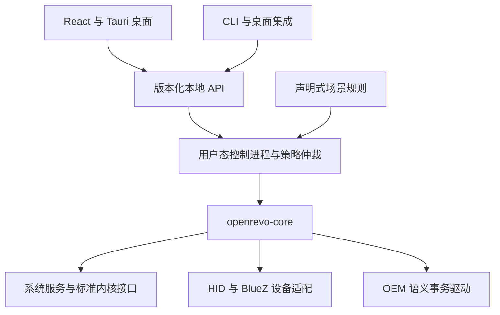

# OpenRevo Linux 项目发展计划

制定日期：2026-11-01。代码基线：本仓库 `main` 的 `e29c22402cab20bf701b9c87ce00bd67a02a524e`，应用版本 `0.9.3-linux.2`。上游功能参照为 `faintonce/open-revo` 的 `main`，本次远端核对为 `b7d2b526e60cd04965eadab21e606bdb1e1aa56e`。后续里程碑是建议，功能验证状态以具体发布记录为准。

项目定位是面向机械革命及相关同方机型的 Linux 原生控制中心：保留上游主要用户能力，采用适合 Linux 的实现，并逐步建立机型适配、场景配置和扩展生态。当前最合适的发展顺序是：稳定已有硬件控制，补齐日常高频功能，形成统一控制 API，再扩大硬件与插件生态。

实施进度：2026-11-01 已完成 M0，交付 [功能与验证台账](linux-feature-ledger.md)、[固定开发工具链](development-toolchain.md) 及 [本轮验证结果](m0-validation.md)。下文的现状与依赖版本分析保留制定计划时的基线；当前开发版本以工具链文档和锁文件为准。

## 当前基础与主要差距

现有项目已具备继续发展的架构基础。React 界面、Tauri 桌面宿主、独立 `openrevo-core` 和 OEM 内核驱动已经分层；系统接口与 OEM 控制并存；硬件字典由 Rust/C 共用生成，驱动提供语义事务、回滚和风扇保护。完整 Debian 包已合并 GUI 与 DKMS 源码，普通用户运行应用。

成熟度应定义为“已有工程验证和单机实测的 Linux 预览版”。目前 OEM 写入只支持 `MECHREVO / GM5HG7A / BIOS N.1.09MRO19`。模式与功耗写入读回、短时强冷恢复已有实测记录，实际功耗效果、曲线带载散热以及重启、休眠实测尚未完整覆盖。标准接口的可用范围更广，但取决于内核和权限，不能据此扩大 OEM 支持承诺。依据见 [Linux 功能与边界](linux-port.md)、[重构验证记录](linux-refactor.md)、[当前版本说明](linux-release-notes.md)。

| 已有资产 | 实际差距 | 对发展顺序的影响 |
| --- | --- | --- |
| OEM 模式、CPU 功耗、强冷与八点风扇曲线 | 软件实现领先于带载和生命周期实测 | 先完成验证闭环，再提供可选的自动应用 |
| 标准限充、背光、hwmon 与 powercap 适配 | 当前主机型未公开标准限充接口；权限和通道因机器而异 | 单列“主机型实际可用”，避免用通用代码代替功能交付 |
| 类型化 IPC、状态轮询和诊断导出 | 能力描述主要为布尔值；错误多为字符串；缺少统一过期状态 | 建立可被 GUI、CLI、自动化共用的能力与错误契约 |
| 主题与曲线草稿 | 主要保存在 localStorage；无命名场景、配置迁移和控制 CLI | 优先补配置基础，保存与自动应用分别处理 |
| GPU、RGB、水冷、插件导航 | 对应 Linux 控制或运行环境尚未实现 | 按设备与使用价值逐项交付完整功能 |
| CI、原生窗口测试、内核故障注入和完整包校验 | 缺少更完整的 Wayland、干净系统安装和真实生命周期矩阵 | 扩展现有测试体系，保持编译、模拟和实机结论分开 |
| main 与 Tag 发布 | 当前工作流只接受 Linux 预览 Tag | 稳定发布前补正式版本通道 |

本次实际执行 `pnpm check`：34 项 Python 测试、41 项 Rust 核心测试、TypeScript 与硬件字典检查通过；执行 `make -C drivers/openrevo-ec test`：6 项生成器测试及 333、416 个事务故障注入点通过。未新增实机写入、模块加载或原生窗口实测；窗口和安装结果引用既有版本记录。测试通过证明相应软件行为，不能替代物理散热与功耗验证。

## 功能对齐范围

对齐单位是用户完成的任务。每项功能都要包含设备发现、能力说明、权限、设置、实际状态、失败处理和验证记录。上游有页面或协议代码，不自动意味着所有型号都可用；本表是基于[上游功能说明](https://github.com/faintonce/open-revo/blob/b7d2b526e60cd04965eadab21e606bdb1e1aa56e/README.md)和本地实际实现制定的交付范围。

| 功能 | Linux 当前状态 | 目标与顺序 |
| --- | --- | --- |
| CPU、内存、温度、风扇、电池监测 | 已实现，数据取决于接口 | P0：数据来源、时间戳、未知和过期状态；P1：可比较的短时历史 |
| 系统档位与 OEM 性能模式 | 已实现，两个控制层独立 | P0：验证负载效果与恢复；P1：提供可解释的组合场景 |
| CPU 功耗与自定义曲线 | 已实现并有软件保护，带载验证不足 | P0：完成验证；P1：命名预设、导入导出和明确的应用策略 |
| 电池养护与限充 | 标准接口已实现，主机型尚不可用 | P1：核实主机型协议和读回能力；必要时新增受审查的 OEM 语义操作 |
| 屏幕与单色键盘亮度 | 标准接口已实现 | P1：设备选择、权限变化、热插拔体验 |
| RGB 键盘、灯带与灯区 | 尚未实现 | P1：确认设备后实现基础颜色和固件灯效；P2：分区映射及可选软件动效 |
| GPU 状态与能耗 | 可读部分 hwmon 数据，无完整 GPU 能力模块 | P1：适配器识别、休眠状态和按需遥测；避免轮询唤醒独显 |
| GPU Dynamic Boost、TGP 与超频 | 尚未实现 | P2：分别调查 OEM 与 GPU 驱动接口；有可验证的限值和恢复路径才提供控制 |
| GPU MUX 与显卡拓扑 | 尚未实现 | P2：区分应用渲染 offload 与物理 MUX；后者按机型验证重启、外屏和恢复 |
| BLE 水冷 | 尚未实现 | P2：BlueZ 发现、连接、遥测、保守控制、断线处置；需要测试设备 |
| 全局快捷键、OSD、机身按键 | 尚未实现对应 Linux 功能 | P1：受支持桌面的快捷键与通知；P2：按键事件及模式状态闭环 |
| 托盘快捷控制与刷新率 | 有托盘打开和退出，无上游完整快捷抽屉 | P1：复用同一命令 API 增加常用控制；刷新率按桌面接口能力提供 |
| 摄像头、触控板、Win 键等开关 | 无专用控制实现 | P2：逐项区分桌面设置与硬件开关，不用软件状态冒充硬件断电 |
| MiniLED、通电开机等固件功能 | 尚未实现 | P2：建立设备清单与协议证据，保留可用性说明及恢复方案 |
| 自动化规则与场景切换 | 尚未实现 | P1：电源、温度事件与声明式规则；应用触发先支持用户显式启动场景 |
| 用户插件与机型配置 | 仅保留 Windows 历史文档和样例 | P2：Linux 数据配置与 SDK；P3：隔离代码扩展和分发目录 |

P0 是稳定性与正确性前置工作，P1 是第一轮主要交付，P2 是依赖协议、设备或 API 基础的后续工作，P3 是规模扩大后再建设的生态设施。P2 功能保留在路线中，排期随可用硬件调整。上游原始硬件网关的扩展用途，通过受限语义 API 实现；不恢复任意寄存器写入入口。

## 技术路线

### 保留现有主栈并更新维护基线

继续使用 Rust、Tauri 2、React 和 TypeScript。当前独立 core 已允许替换桌面界面，现阶段更换为 Qt、GTK、Slint 或其他前端框架不能直接解决机型协议和验证缺口。只有在测量确认 WebKit 的资源占用、无障碍或桌面兼容问题成为主要瓶颈时，才做同功能原型对比。

需要更新的是依赖维护方式。锁文件中的 Vite 为 `5.4.11`、React 为 `18.3.1`；Tauri JS API 和 CLI 已锁到 2.11 系列，不能仅凭清单中的 `^2.0.0` 判断其陈旧。Vite 5 已不在[官方支持范围](https://vite.dev/releases)，应优先按迁移指南升级到实施时受支持的稳定版本，同步校验 Node LTS、插件和 TypeScript；React 可随后迁往[当前主版本](https://react.dev/versions)，分开回归，避免与硬件行为改动混在一次提交。

固定正式构建使用的 Rust、Node、pnpm 和测试工具版本，保留锁文件并安排定期更新。增加依赖审计与可追溯构建信息；不把“版本旧”直接等同于已存在漏洞。数据量较小时使用带 schema 版本的 XDG JSON 配置和内存历史缓存，出现明确的长期历史查询需求后再引入数据库。

### 建立共享控制契约

首先在现有 core 内完善契约，再按需求拆出进程。建议能力状态分为独立维度：实现与设备支持、当前读写权限、实测等级；另附驱动状态、不可用原因和处理建议。`可读取`、`可控制`、`带载已验证`应分别表达。

公共命令返回结构化结果，包括错误码、失败阶段、当前状态、恢复结果；快照带采样时间和来源。Rust 与 TypeScript 类型由统一 schema 生成或在 CI 中校验一致性。配置采用 XDG 路径、版本迁移、原子保存和可恢复备份；预设记录机型、能力与适用范围，导入时重新校验出厂上限。配置文件不能改变协议地址、伪造出厂上限或扩大 BIOS 白名单。

当前每两秒状态读取同时续租，宿主另有 watchdog；多客户端出现前要拆开“读取状态”和“拥有控制权”。诊断读取不应替另一个已退出的控制者续租。协议应明确手动操作、自动规则、临时覆盖的优先级，以及用户退出、进程异常、会话失活、断电和休眠后的行为。

### 按后台需求引入单一控制进程

当实现无窗口规则、CLI 和桌面挂件时，增加普通用户运行的 `openrevo-agent`，由同一个进程拥有控制租约，GUI 和 CLI 通过版本化本地 API 使用它。服务可以由 systemd 用户实例按需启动，继续由现有 core 执行硬件策略。普通桌面客户端不取得额外系统权限；现有 logind、系统电源服务和设备权限机制继续生效。

这是中期目标，当前阶段无需立即增加常驻进程。GUI 退出与“停止后台策略”必须成为明确的两个操作；默认保留现有曲线/强冷恢复行为，持续后台控制由用户显式启用。内核租约、限值、事务及恢复机制继续独立工作，不能依靠 agent 永远存活。跨用户、会话切换和设备 ACL 变化也必须参与控制权校验。

## 分阶段实施

工作量按一名主要维护者估算，为有效开发周，不是发布日期承诺；硬件借测、固件差异和社区协作可能显著延长周期。依赖更新、文档和独立设备调查可以并行，控制契约稳定后再扩展自动化及插件。

| 阶段 | 参考工作量 | 主要交付 | 进入下一阶段的门槛 |
| --- | --- | --- | --- |
| M0 建立可维护基线（已完成） | 原估算 1–2 周 | 功能/机型验证台账、依赖升级、构建工具固定、发行日志整理、能力状态设计 | 已通过，见 M0 验证记录；真实硬件验证等级保持原边界 |
| M1 稳定现有控制 | 2–4 周加实机窗口 | 结构化错误、过期状态、驱动安装状态可视化、配置 schema、生命周期与带载验证 | 支持机型有完整恢复证据；无未解释的控制状态；安装与升级验证覆盖声明支持的环境 |
| M2 完成 Linux 日常工作流 | 3–5 周 | 命名预设、控制 CLI、按需 agent、电源/温度规则、快捷键与托盘快捷操作 | 多客户端不争抢；退出/失活按约定恢复；规则可暂停和解释；不额外唤醒休眠独显 |
| M3 补齐首批上游功能 | 4–8 周，按设备拆分 | 主机型限充调查与实现、基础 RGB、GPU 识别与按需遥测；第二机型适配流程 | 至少一个新增硬件功能端到端实测；新增机型有独立证据，未知组合仍降级 |
| M4 扩展高级硬件能力 | 每个协议族单独估算 | BLE 水冷、GPU 功耗/MUX、灯区动效、机身开关与特殊屏幕功能 | 每个功能分别通过限值、读回、异常、恢复及兼容矩阵；不能整页一次宣称支持 |
| M5 建立扩展生态 | M2 契约稳定后，首版约 4–6 周 | 声明式扩展、Linux SDK、开发样例、权限与版本策略；隔离代码扩展随后交付 | 扩展无法绕过硬件语义边界；可撤销、可停用；升级/崩溃不遗留控制 |

前 90 天建议以完成 M0、M1 和 M2 的主要闭环为目标，并在设备可得时交付 M3 的一个完整功能。暂不把全部水冷、MUX 和插件市场同时纳入该窗口。若维护者时间有限，优先保持现有控制可靠，再选择主机型确实具备的 RGB 或限充作为第一个功能扩展。

`1.0` 建议定义为“明确支持范围内可靠、可安装、可恢复的 Linux 控制中心”，允许仍有标注清楚的后续功能。上游主要能力的覆盖继续在后续版本推进；不以页面数量或笼统的“移植完成百分比”作为稳定发布条件。

## 硬件功能的实施顺序

RGB 优先复用上游协议知识和纯算法，在 Linux 重新实现设备发现、访问权限和生命周期。先做静态颜色、亮度与固件灯效，随后支持分区、灯带及软件帧动画。只有设备确认使用 HID 时才选择 hidraw/HIDAPI，并按设备标识与接口匹配；帧布局仍由硬件字典管理。Linux 的 [hidraw 文档](https://docs.kernel.org/hid/hidraw.html)提供用户态设备访问依据，不能据此假定每款键盘协议相同。

水冷使用 [BlueZ GATT API](https://bluez.readthedocs.io/en/latest/gatt-api/)调查和实现通信，先交付连接、遥测和故障状态，再加入泵/风扇控制。断连后设备是否保持最后设置、是否具有自主保护，都要通过协议与实机确认。无法证明脱离主机后仍安全时，不启用依赖持续连接的激进自动策略。

GPU 按“识别与遥测 → 应用渲染选择 → 可用功耗控制 → 固件 MUX”分开推进。不能把启动应用时指定显卡当作物理直连切换，也不能假定 Windows 的 NVAPI、Dynamic Boost 或超频能力在 Linux 有等价接口。每类适配记录驱动版本、设备型号、供电与外屏条件。

桌面集成优先使用 [GlobalShortcuts Portal](https://flatpak.github.io/xdg-desktop-portal/docs/doc-org.freedesktop.portal.GlobalShortcuts.html)，按桌面后端实际支持情况启用。OSD 首版使用桌面通知或受控窗口；快捷键、全屏显示、刷新率和前台应用检测逐项记录 GNOME/KDE、Wayland/X11 支持范围。自动化先提供显式场景启动和电源事件，不承诺在所有 Wayland 桌面透明读取前台窗口。

## 机型与插件生态

机型支持库首先收集可验证的知识：DMI/BIOS、协议族、设备标识、语义能力、限制、验证等级、已知问题和维护人。协议地址、掩码、定长帧仍只登记在现有字典/HAL；普通用户配置仅保存安全范围内的偏好。新 BIOS、新主板不能仅凭营销型号相近自动获得写权限。

贡献路径分为只读诊断、回放夹具、协议审查、离线故障测试和经明确授权的实机测试。诊断默认不收集序列号，用户可检查后再提交。第一个扩展里程碑是第二套独立验证的机型或 BIOS 组合；没有借测设备时，继续建设流程和模拟夹具，不放宽匹配条件。

扩展生态从三个小规模产品开始：可分享的命名场景、经过验证的机型支持资料、受限声明式规则。先提供只读遥测和有限语义动作，加入能力声明、限频、超时、优先级和撤销机制。第一批规则可包括接电切换场景、低电量减少灯效、温度阈值通知。

第三方可执行插件应放在独立进程或经评估的 WASM 沙箱中；选择由功能和资源测量决定，不预先叠加多套运行时。插件不得直接继承主应用的设备、文件系统、网络或完整会话总线权限。当前 `csp: null` 和默认 capability 的 `windows: ["*"]` 是开放第三方内容前需要处理的边界，不能直接把不受信内容放进主窗口；[Tauri capabilities](https://v2.tauri.app/security/capabilities/)需要与自定义 IPC 授权和宿主 API 一同设计。

先发布版本化 Linux SDK、两三个可运行样例和迁移说明，再考虑插件目录、签名与更新机制。原 Windows 插件文档继续标为历史参考，不承诺二进制或 manifest 的全面兼容。社区初期用仓库内审核目录即可，不需要先建设云平台或账号体系。

## 验证与发行门槛

| 层级 | 必须保留或新增的验证 | 结论范围 |
| --- | --- | --- |
| 每次相关修改 | `pnpm check`；驱动事务测试；对应 lint/build 与既有窗口回归 | 类型、协议约束、故障处理和界面行为 |
| 每个候选包 | 完整 `.deb` 校验、应用/驱动源码与版本记录、升级/卸载测试 | 包内容与安装逻辑；模拟加载不能代替真实加载 |
| 每种支持系统 | 干净 VM 安装/升级、缺 headers 后恢复、DKMS 内核升级重建、Secure Boot 流程 | 声明范围内的分发兼容性；VM 不证明 OEM 调校有效 |
| 每个硬件控制族 | 支持机型上的读回、保守带载、断电、异常退出、租约过期、休眠/唤醒、重启与恢复 | 对应机型、BIOS、内核和版本的控制行为 |
| 每个桌面目标 | GNOME/KDE 的 Wayland/X11 窗口、托盘、自启、快捷键、缩放与键盘操作 | 实际测试组合的桌面可用性 |

硬件测试采用分步清单，事先记录原状态、供电条件、停止阈值和恢复方式。测试阈值来自已验证机型边界，不设跨机型通用的“安全温度/功耗”。模块安装、替换及实机调节与离线检查分开授权和执行；本计划不视为这些动作的授权。

性能验收先建立本机基线，比较空闲与最小化时的整个进程树内存、CPU 时间/唤醒、遥测时延、额外功耗和独显休眠。优化优先处理重复发现、无必要轮询和控制锁竞争；任何减少 UI 轮询的改动都必须同时验证租约行为。软件 RGB 单独报告资源消耗，电池模式默认优先固件灯效。

首批正式支持范围应从已有实测机器和明确选定的 Ubuntu/Debian 环境开始。当前 GUI CI 在 Ubuntu 22.04 上用 Xvfb 跑窗口测试，Ubuntu 24.04 的矩阵主要证明模块编译；两者都不能直接扩写成所有发行版与 Wayland 已支持。新增 RPM、AUR 或沙箱 GUI 发行方案，以明确用户需求和维护资源为前提，近期继续公开一个完整 `.deb`、对应源码及 SHA-256 清单。

维持 `main` 加 Tag 流程。现有 [发布工作流](../.github/workflows/linux-release.yml)仅匹配 `v*-linux.*` 并固定为预览草稿；正式发布前增加普通稳定 Tag 的版本验证和发行路径，仍以 `tauri.conf.json` 为版本来源。为各清单中基础版本与发行版本的关系建立自动校验，避免人工维护产生漂移。发布说明逐项列明新增能力、验证矩阵和已知限制。

## 首轮可执行任务

| 顺序 | 工作项 | 完成标准 |
| --- | --- | --- |
| 1 | 建立功能与硬件验证台账 | 本计划的对齐项各有实现状态、测试等级、证据和下一步；新增能力沿用同一格式 |
| 2 | 更新构建依赖并固定工具链 | Vite 迁入受支持版本；完整构建、原生窗口和打包回归通过，工具版本可追溯 |
| 3 | 细化能力状态与结构化错误 | UI 区分只读、缺权限、驱动未就绪、待重启、实验能力和恢复故障 |
| 4 | 将驱动安装诊断接入界面 | 展示 driver-status、运行中协议及版本、下一步操作；旧数据带时间提示 |
| 5 | 建立 XDG 配置与预设 schema | 草稿可迁移、导入导出可校验；保存不会隐式变为启动写硬件 |
| 6 | 扩展生命周期测试清单 | 完成离线场景；另行安排授权后的实机功耗、曲线、断电与睡眠恢复验证 |
| 7 | 收拢遗留 UI 样式 | SponsorView、ModuleErrorBoundary、RevSwitch 等使用统一 tokens；Mono/Cyber 和最小窗口验证通过 |
| 8 | 测量轮询与控制生命周期 | 有资源基线；只读观察不延长其他控制者租约；后台节流行为有测试 |
| 9 | 定义 CLI 和规则 API | 错误码、能力 schema、控制权、租约和事件稳定后，复用 core 实现首个客户端 |
| 10 | 选择首个新增设备功能 | 根据本机设备和协议证据，在基础 RGB、OEM 限充等项目中完成一个端到端闭环 |

## 与上游的长期协作方式

维护功能差异台账，记录上游提交、用户需求、本项目能力、采用方式与验证结果。每个开发迭代检查上游稳定分支；开发分支作为协议和功能线索，经单独审查后采用。此次上游 `main` 已核对，`dev` 远端为 `4a9bee11394324e878d3f9f9a4e81d25f0700b93`，其新增内容不计入本计划的已核实功能基线。

优先吸收协议修正、纯算法、设备知识和可复用测试；Windows 系统调用、权限模型、后台服务和桌面交互采用 Linux 实现。保留来源、版权和许可说明，避免周期性整体合并把 Windows 依赖重新带回活跃构建图。可独立复用的协议修正可以向上游贡献。

项目的长期优势应来自可靠的 Linux 电源与散热管理、可核验的机型支持库、低开销后台策略，以及可被 CLI、桌面集成和受控插件共用的稳定能力接口。功能对齐台账持续推进，架构与发行节奏由 Linux 用户的实际体验决定。
