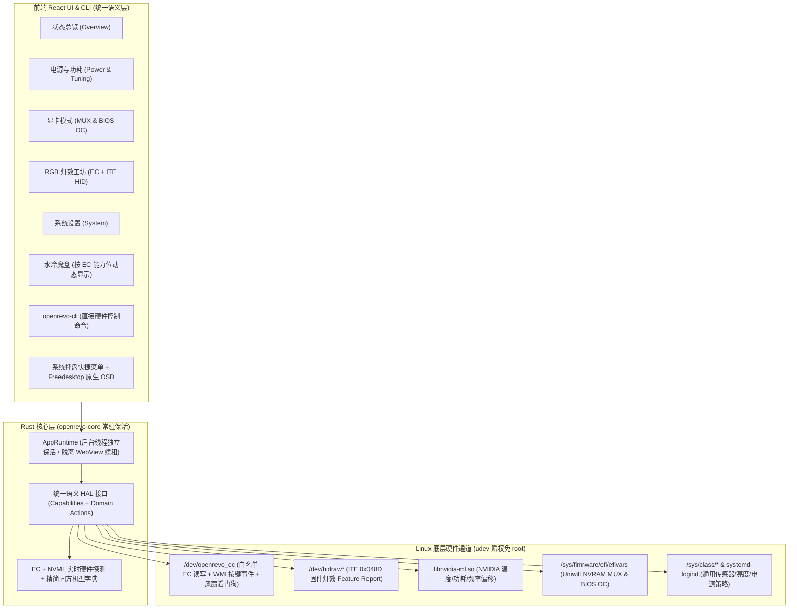

# OpenRevo Linux 架构重构与功能对齐蓝图

> [!IMPORTANT]
> 本蓝图完全基于当前代码库（`src/`、`src-tauri/`、`drivers/openrevo-ec/`）与原版 `faintonce/open-revo`（`upstream/main`）的代码对比及 13 轮架构对齐问答生成，旨在彻底终结当前“过度防卫、双轨割裂、半数 Tab 占位”的状态。

---

## 一、 核心架构决策总览

### 1. 硬件边界与抽象层（HAL）
- **聚焦同方（Uniwill WMI）模具**：彻底移除宝龙达（BLD）、IP3、木珑等异构代工包袱，先把同方全系功能做全做透。
- **消除前后端 `oem` / `sysfs` 双轨分裂**：在 [`openrevo-core`](file:///home/tanglei/桌面/open-revo/src-tauri/crates/openrevo-core/src/lib.rs) 中收敛为统一的“能力（Capabilities）+ 语义动作（Actions）”接口，前端不再写 `status.oem.available ? <Oem*> : <Sysfs*>` 分支，既简化前端又为未来扩展其他模具保留零返工边界。
- **机型识别策略**：去除 [`openrevo_ec.c`](file:///home/tanglei/桌面/open-revo/drivers/openrevo-ec/openrevo_ec.c#L283-L286) 中死锁的 `GM5HG7A` + `N.1.09MRO19` 单一 BIOS 锁，改为 `MECHREVO` 厂商 + Uniwill WMI GUID 匹配（并提供 `force` 模块参数）；在 Rust 层以 **EC 寄存器 + NVML 实时自探测为主，精简版同方机型字典兜底**。

### 2. 内核模块与用户态职责切分
- **瘦身 [`drivers/openrevo-ec`](file:///home/tanglei/桌面/open-revo/drivers/openrevo-ec/openrevo_ec.c)**：
  1. 开放基于 [`ec_registry.json`](file:///home/tanglei/桌面/open-revo/src-tauri/config/ec_registry.json) 的 `linux_ec_read` / `linux_ec_write` **白名单寄存器读写**，移除 C 端臃肿的业务状态机（`control_transaction.h`），所有业务规则统一收归 Rust (`openrevo-core`)。
  2. 保留内核级**风扇曲线/强冷失联看门狗兜底**，确保进程崩溃时硬件安全恢复自动散热。
  3. 新增 **WMI 热键事件监听**（GUID `ABBC0F72-8EA1-11D1-00A0-C90629100000`），将机身物理模式切换键（Q-Key）与 `Fn` 组合键事件暴露给用户态。

### 3. 进程生命周期与桌面体验
- **Rust 后台独立保活**：硬件控制与风扇曲线续租下沉至 [`AppRuntime`](file:///home/tanglei/桌面/open-revo/src-tauri/crates/openrevo-core/src/runtime.rs) 后台线程，不再依赖前端 WebView 定时器心跳。
- **常驻系统托盘**：拦截主窗口 `CloseRequested` 事件隐藏至托盘；增强托盘菜单（支持直切办公/均衡/狂暴/自定义模式、开关强冷、切换电池模式）。
- **Linux 原生 OSD**：物理按键切换模式或背光时，发送 Freedesktop 原生桌面通知，砍掉在 Wayland 下无法定位且抢焦点的多 WebView 浮窗（`OsdOverlay` / `MiniDrawer` / `WidgetHost`）。
- **完备 `udev` 规则集**：扩展 [`70-openrevo-ec.rules`](file:///home/tanglei/桌面/open-revo/drivers/openrevo-ec/70-openrevo-ec.rules)，覆盖 `/dev/openrevo_ec`、ITE USB HID（`0x048D`）、电池限充与 `powercap`，实现普通用户零 `sudo` 全功能控制（低频重启生效的 EFI NVRAM 修改按需通过 `pkexec` 或驱动完成）。

---

## 二、 删减清单 vs 补齐清单

| 类别 | 明确砍掉 / 清理的冗余设计 | 明确补齐 / 重构的核心功能 |
| :--- | :--- | :--- |
| **交互与配置** | 砍掉 1600 行的 [`NamedScenes`](file:///home/tanglei/桌面/open-revo/src/components/linux/NamedScenes.tsx)（命名场景表单、预检与回滚报告） | 回归原版 **`[办公] [均衡] [狂暴] [自定义]` 四档模式直切**与配置自动持久化；重构 [`openrevo-cli`](file:///home/tanglei/桌面/open-revo/src-tauri/crates/openrevo-core/src/bin/openrevo-cli.rs) 为直观的硬件控制命令（`mode`/`fan`/`battery`/`switch`） |
| **状态总览** | 清理 `oem` 与 `controls` 割裂的卡片与残留空目录 | 恢复 **机身硬件快捷开关面板**（Win 锁、Fn 锁、摄像头物理断电、关机 USB 供电、来电自启、触摸板、机身模式指示灯联动）+ **EC 原生电池管理**（满充/均衡/长效三档 + 自定义上下限双阈值） |
| **功耗与调校** | 移除 C 内核模块中重复的 PL4 校验状态机 | 补齐 **CPU TCC 温度墙** + **EC 原生 GPU 功耗管线**（宽幅 cTGP 偏移 `ADDR_TGP_OFFSET` + Dynamic Boost `ADDR_DB_WATTS1` + 满血超能模式）+ **Linux `NVML` 接入**（N 卡实时温度/功耗/频率读取与核心/显存超频） |
| **显卡与显示** | 砍掉 Windows 专属的 ICC 校色、Gamma 色温与多混成器刷新率切换 | 移植 **UEFI NVRAM (`efivars`) 显卡模式切换**（独显直连 / 混合输出 / 纯集显）+ **BIOS 隐藏 CPU/内存超频菜单解锁** + **屏幕亮度 & EC MiniLED 分区背光开关** |
| **RGB 灯效** | 砍掉高 CPU 占用的软件流光引擎（屏幕拾色/音频律动/`.brfx`） | 移植 **全套硬件原生灯控**：EC 单色/单区 RGB 键盘灯、EC 海岸线灯带 + **ITE USB HID (`hidraw`)** 单键/四分区/灯带固件级灯效与休眠自动灭灯 |
| **水冷与插件** | 彻底砍掉「插件 (Plugins)」Tab；默认按 EC 能力位隐藏「水冷魔盒」Tab | 彻底消灭所有“此功能尚待移植”死卡片；BlueZ 水冷作为远期可选模块 |

---

## 三、 分阶段实施路线图（Phased Execution Plan）

### Phase 1：地基清理与内核/运行时解耦（Foundation & Cleanup）
1. **内核驱动改造**：重构 [`drivers/openrevo-ec/`](file:///home/tanglei/桌面/open-revo/drivers/openrevo-ec/openrevo_ec.c)，开放 [`ec_registry.json`](file:///home/tanglei/桌面/open-revo/src-tauri/config/ec_registry.json) 白名单寄存器读写，放宽 DMI 匹配（去除单 BIOS 锁），保留风扇看门狗，加入 WMI 物理按键事件支持。
2. **清理冗余与死代码**：移除 `NamedScenes`（`scenes.rs`、`scene_commands.rs`、`NamedScenes.tsx`）、移除「插件」Tab、按能力位动态隐藏「水冷」Tab、清理残留空文件夹。
3. **常驻保活与接口统一**：将控制续租移入 [`AppRuntime`](file:///home/tanglei/桌面/open-revo/src-tauri/crates/openrevo-core/src/runtime.rs) 后台线程，修复主窗口关闭隐藏到托盘，统一前后端语义快照与控制命令，重写直观的 `openrevo-cli`。

### Phase 2：总览快捷开关、EC 电池养护与物理按键联动（Overview & Switches）
1. 在 `openrevo-core` 与前端总览页接通 **EC 电池三档模式 + 双阈值限充**。
2. 恢复 **硬件快捷开关面板**（Win 锁、Fn 锁、摄像头断电、关机 USB 充电、来电自启、MiniLED 开关、模式指示灯同步）。
3. 接通 **WMI 物理模式键（Q-Key）四档循环切换** + 系统托盘快捷菜单 + Freedesktop 原生 OSD 通知。

### Phase 3：四档模式直切、CPU TCC 与 GPU (EC + NVML) 深度调校（Power & GPU Tuning）
1. 打通 **`[办公] [均衡] [狂暴] [自定义]`** 四档模式一键切换与参数持久化。
2. 补齐 **CPU TCC 温度墙** 与 **EC GPU 功耗管线**（`WideCtgpPipeline` / `FullPowerPipeline`：cTGP 偏移 + Dynamic Boost 调节）。
3. 动态加载 Linux `libnvidia-ml.so`（NVML），补齐 NVIDIA 显卡实时温度、功耗、显存、频率监控与核心/显存频率偏移调节。

### Phase 4：显卡直连（UEFI NVRAM MUX）与 RGB 灯效工坊（MUX & Lighting Studio）
1. 基于 `/sys/firmware/efi/efivars/` 实现 **独显直连 / 混合输出 / 纯集显** 切换与 **BIOS 隐藏 CPU/内存超频菜单解锁**。
2. 基于 `/dev/openrevo_ec` 与 `/dev/hidraw*` 实现 **RGB 灯效工坊**（EC 键盘/灯带 + ITE `0x048D` 单键/四分区/USB 灯带固件灯效、亮度、速度与睡眠灭灯）。

---

## 四、实施记录（2026-11-02）

本蓝图为当前开发维护依据；`AGENTS.md` 已记录优先级。`docs/linux-roadmap.md` 保留为历史路线，不能覆盖本蓝图的删减与阶段顺序。

第一批完成 Phase 1 中的界面清理与运行时基础，并接入四档语义模式；**Phase 1 整体仍在进行，Phase 2–4 未完成**。

| 项目 | 当前实现 |
| --- | --- |
| 后台保活 | `AppRuntime` 独立线程每两秒维护控制租约；WebView 不再发送心跳，状态读取不续租；退出停止线程并释放临时控制 |
| 统一控制入口 | `Action` 和 `domains.performance/cooling` 供 GUI、托盘、CLI 共用；EC / sysfs 的选择在 Rust 后端，前端不再分两套调校组件；原始快照保留作诊断 |
| 四档模式与配置 | 办公 / 均衡 / 狂暴 / 自定义按实时能力启用；成功应用后保存模式、自定义 CPU 参数和曲线；配置 v3 兼容 v1/v2，旧场景仅存入 `legacy_scenes`，原配置首写备份 |
| 界面清理 | 撤下 NamedScenes 组件、场景执行器、场景 IPC/CLI 和专用 CSS；移除插件 Tab、未实现能力的水冷入口和“此功能尚待移植”卡片；显示/灯光页面保留已实现的标准亮度控制 |
| 桌面与 CLI | 主窗口关闭后隐藏至托盘，托盘创建失败时正常关闭；提供四档、强冷与恢复自动操作；CLI 提供 `mode` / `fan` / `cpu` / `battery` / `brightness` / `status` / `config` / `release-controls` |
| 第一批之后的 Phase 1 工作 | 驱动、Rust 事务、WMI 与水冷能力探测见下方第二批记录；不要再采用第一批时的驱动边界 |
| 后续硬件阶段 | EC 电池三档/双阈值、硬件开关与 CLI `switch`、按键联动和原生 OSD、TCC / GPU / NVML、EFI MUX / BIOS OC、EC / ITE HID 灯效及对应权限规则 |

配置自动保存与开机自动应用分别处理：本批启动、导入仅载入设置，不自动写硬件。CLI 仍连接运行中的普通用户桌面进程，窗口可隐藏；没有新增独立系统服务。

本批只执行软件构建、隔离窗口回归和离线测试，没有安装/加载模块或调节真实硬件。后续新增硬件能力继续按阶段实现，并分别记录离线验证与实机结果。

验证记录：`pnpm check`（35 项 Python、76 项核心、1 项 CLI、TypeScript 与硬件字典门禁）、workspace Clippy、Tauri 调试构建通过；15 项原生窗口回归通过，包含关闭隐藏后 CLI 仍可访问后台、四档/完整 CPU 参数提交、配置迁移和状态过期后的显式恢复。驱动原有 6 项生成器测试与 333/416 个事务故障注入点通过。窗口截图与隔离配置保存在 `test-results/linux-webdriver-8ql1prmn/`，检查日志为 `/tmp/openrevo-architecture-check.log`。这些结果不代表新机型、硬件写入或带载散热已验证。

### 第二批：驱动传输与 Rust 业务事务（2026-11-02）

已落地 Phase 1 的驱动迁移，以下只表示实现与离线验证，不表示同方全系已实测：

| 项目 | 已实现与边界 |
| --- | --- |
| 字典与传输 | 共享字典生成读写白名单；单次仅一个字节，写集合必须可读回。风扇表、锁存器和出厂表不在写白名单。移除宝龙达地址/掩码，模式请求与指示灯常量改为业务命名 |
| 业务迁移 | 删除 C `control_transaction.h`，模式/CPU 功耗的供电校验、出厂上限、读回、回滚与后台恢复迁入 Rust HAL。暂存前关闭自定义功耗，PL4/PL2/PL1 依次写入；共享位保留，固件消费静音请求的既有规则保留 |
| 内核散热保护 | 保留整表风扇事务；强冷也由内核保存原位、比较最后写值并恢复，避免用户态用旧状态覆盖外部变更。关闭文件、失联超时、休眠和移除时尝试恢复；仍可访问设备时重试失败恢复。迟到心跳不能复活过期租约，续租不推迟已排队的断电检查 |
| 匹配与版本 | MECHREVO 厂商 + Uniwill WMI，去除主板/BIOS 锁；`force=1` 仅绕过厂商检查且默认关闭。新增 `transport_abi=1`，风扇 ABI 升为 2；旧应用/新驱动与新应用/旧驱动均不开放写入 |
| WMI 事件 | 独立只读 `/dev/openrevo_events`，独占读取、64 项队列、16 字节小端版本帧。Rust 后台非阻塞读取原始代码与序号，诊断统计缺失事件；不猜测事件码或触发硬件动作。系统驱动已占用 GUID 时报告不可用，不抢占绑定 |
| 水冷探测 | EC 两处能力位只读探测，肯定值为 true、两处明确否定才为 false，读取不足为未知。BlueZ 控制与水冷操作页未实现，不创建占位页 |
| 打包与 CI | 完整包带新驱动头、离线夹具和测试；udev 规则覆盖 EC 与事件设备，安装器刷新已存在事件节点权限。CI 加入发行版头文件下的模块编译，仅构建不加载 |

Rust 回滚备份只在当前进程内；崩溃后内核能处理临时散热所有权，但不能重放未完成的模式/CPU 事务。原有成功设置仍持久到下次调节。匹配条件放宽不代表未知机型已验证，旧版实机记录不能提升本次驱动的验证等级。

WMI 回调按内核 [WMI 开发指南](https://docs.kernel.org/6.15/wmi/driver-development-guide.html) 处理生命周期与并发，原始整数事件类型参考 [上游 uniwill-wmi](https://github.com/torvalds/linux/blob/master/drivers/platform/x86/uniwill/uniwill-wmi.c)。后续按键映射需补充本机原始事件证据，不能只凭共享 GUID 推断。

后续仍待实施：Phase 2 EC 电池/硬件开关、Q-Key 四档联动及原生通知；Phase 3 TCC/GPU/NVML；Phase 4 EFI/RGB。ITE HID、限充与 powercap 的权限规则随对应功能实现。驱动新 ABI 的实机安装、正常控制、进程异常退出、休眠/断电和带载验证均待单独执行。

本批验证：`pnpm check`（36 项 Python、88 项核心、1 项 CLI、TypeScript 和字典门禁）通过；workspace Clippy、Tauri 调试/发行构建通过。15 项原生窗口回归通过，隔离数据在 `test-results/linux-webdriver-u63snq0m/`。驱动 6 项生成器测试、333 个曲线故障注入点、强冷恢复与白名单/迟到心跳保护测试通过；新增 Rust 事务测试覆盖写前/写后失败、回滚每步失败、重试和断电。模块在 `7.0.0-38-generic` 头文件下编译成功，缺少 vmlinux 导致跳过 BTF，未加载模块。

完整验证包在 `dist_release/architecture-driver-20261102/OpenRevo_0.9.3-linux.2_amd64.deb`，版本沿用当前配置，属于未发布的开发产物。包内容与安装元数据校验通过，尚未安装。日志前缀 `/tmp/openrevo-driver-`。没有修改上级历史归档、安装/替换模块、发布版本或调节真实硬件。

### 第三批：Phase 2 电池、开关与模式键联动（2026-11-02）

本批接通 Phase 2 的主要软件链路；**MiniLED 专用控制、触摸板的 Linux 输入层控制和实机验证仍未完成**。

| 项目 | 当前实现与限制 |
| --- | --- |
| EC 电池管理 | EC 声明电池能力且原策略有效时，提供满充 95/100、均衡 75/80、长效 55/60 和自定义双阈值；上下限范围为 1–100 且下限小于上限。按安全顺序更新阈值，最后更新模式，保留触摸板和其他共享位，逐步及最终读回；失败回滚，恢复失败保留备份由后台重试 |
| 硬件快捷开关 | Win 锁、Fn 锁、摄像头供电、关机 USB 充电、来电自启及触摸板 EC 标记；每项读回状态与写入能力分别显示。修改开关保留模式灯位，模式动作也保留开关位。触摸板项仅是 EC 标记，不承诺关闭合成器/libinput 输入 |
| 版本与所有权 | 新设备功能要求 `device_controls_abi=1`，旧驱动不开放这些写入。能力位/状态无效时保持未知和只读；自定义曲线活动时先恢复风扇策略再调节设备。Win 锁仅在状态不同时发送一次脉冲，丢失回执后读取确认，不自动重发切换命令 |
| 物理模式键 | 字典登记上游已有的三种模式键事件；后台每 100 ms 有界非阻塞读取，维护控制租约仍为每两秒。显式启用后按办公→均衡→狂暴→自定义循环，按实时供电与权限跳过不可用档位，复用相同动作、读回、模式灯及保存路径；首次自定义使用有效的保存参数或办公出厂表 |
| 事件防重放 | 500 ms 去抖，忽略未知事件；序号缺口批次、停顿/恢复和长时间等待控制锁后的旧事件不执行；应用写模式后的事件回声不再触发循环。配置 v3 新增可选 `hotkeys_enabled`，默认 false，关闭窗口后仍工作，异常状态下保留关闭联动入口 |
| 桌面反馈 | 模式成功与按键错误通过 Freedesktop 通知服务投递，独立有界队列与两秒调用超时，不占用硬件线程；通知服务缺失不会撤销已成功的硬件操作。界面同时收到状态刷新/错误事件，没有新建 OSD 窗口 |
| GUI / CLI / 托盘 | 总览接入电池区、双阈值校验和开关面板；CLI 新增 `battery full/balanced/longevity`、`battery custom LOWER UPPER`、`switch NAME on/off`、`hotkeys on/off`；保留 `battery DEVICE LIMIT` 标准接口，托盘增加电池三档 |

没有引入电池平台身份伪装、阈值强制回写线程或启动时自动应用电池/开关设置。EC 可能在特定平台自行限制/覆盖策略；软件读回不等于实际充放电效果已验证。MiniLED 的上游命令属于木珑专用 WMI，当前同方传输不能据此声称支持；其他 Fn 亮度事件也仍只读记录。

协议证据来自本地 `upstream/main` 的 `b7d2b526e60cd04965eadab21e606bdb1e1aa56e`：电池预设/触摸板共享位见 [HAL 实现](https://github.com/faintonce/open-revo/blob/b7d2b526e60cd04965eadab21e606bdb1e1aa56e/src-tauri/crates/openrevo-core/src/hal/driver_impl.rs)，能力位与 Win 锁脉冲见 [WMI EC](https://github.com/faintonce/open-revo/blob/b7d2b526e60cd04965eadab21e606bdb1e1aa56e/src-tauri/crates/openrevo-core/src/driver/wmi_ec.rs)，模式键映射见 [事件监听](https://github.com/faintonce/open-revo/blob/b7d2b526e60cd04965eadab21e606bdb1e1aa56e/src-tauri/crates/openrevo-core/src/driver/wmi_event_listener.rs)，MiniLED 边界见同版本 `src-tauri/src/commands/display_cmd.rs`。这些是移植依据，不是本机新协议实测。通知参数参考 [Freedesktop 规范](https://specifications.freedesktop.org/notification/latest/protocol.html)。

验证结果：`pnpm check`（36 项 Python、100 项核心、1 项 CLI、TypeScript 与字典门禁）、workspace Clippy、调试与发行构建通过；驱动 6 项生成器、333 个曲线故障点及散热保护测试通过，模块在 `7.0.0-38-generic` 头文件下编译成功。新增核心用例覆盖阈值安全顺序/共享位、逐步通信失败回滚、恢复重试、Win 锁不重复脉冲、旧设备 ABI 禁写、模拟 WMI 四档循环/保存/回声/丢帧/禁用。17 项原生窗口回归最终全部通过；首次回归仅配置字段断言未更新而失败，补入 `hotkeys_enabled=false` 预期后重跑通过。

本批窗口夹具拦截真实调节，原生写命令仅提交无效请求；没有安装/加载模块、真实硬件写入或桌面通知外观验证。截图和隔离数据在 `test-results/linux-webdriver-2ghujb8d/`（`ec-battery.png`、`hardware-switches.png`）。完整包在 `dist_release/phase2-20261102/OpenRevo_0.9.3-linux.2_amd64.deb`，内容及安装元数据校验通过，版本沿用配置，是未发布开发产物；本批日志前缀 `/tmp/openrevo-phase2-`。

后续工作：先进行新驱动和电池/开关/原始按键的实机读回与恢复验证，再确认实际充放电和物理设备效果；MiniLED 需找到同方适用的控制通道。Phase 3 的 TCC/GPU/NVML、Phase 4 的 EFI/RGB 保持待实施。
